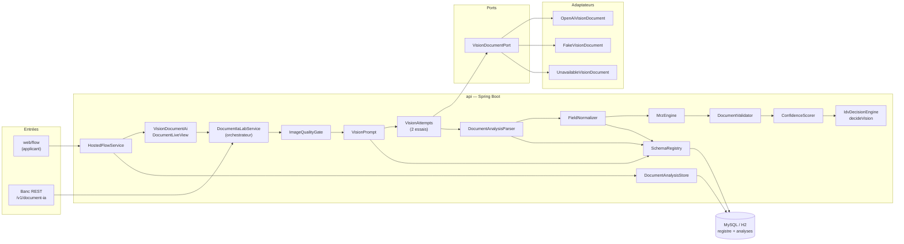
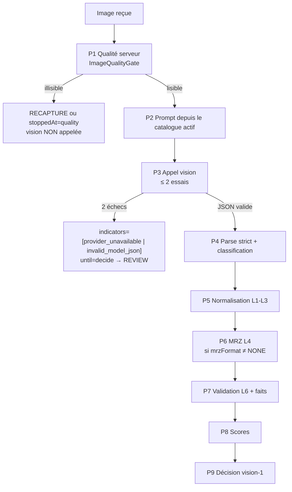
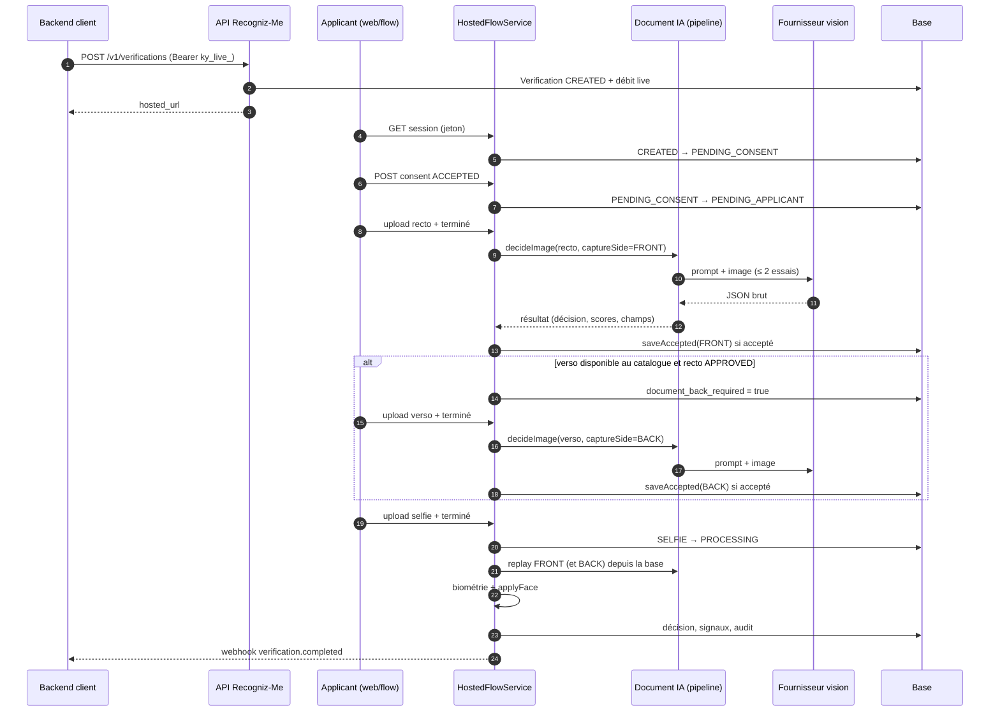
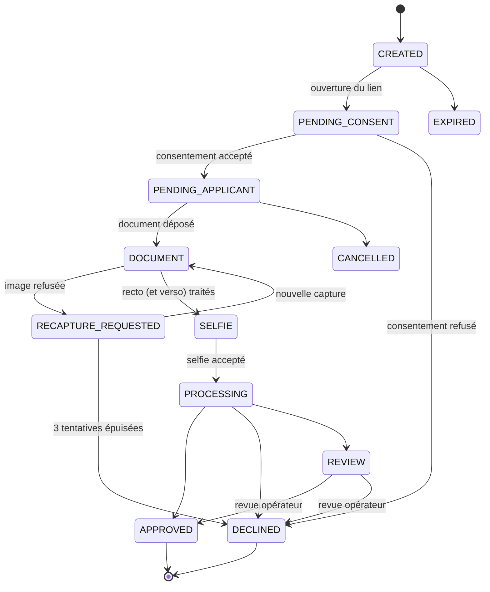
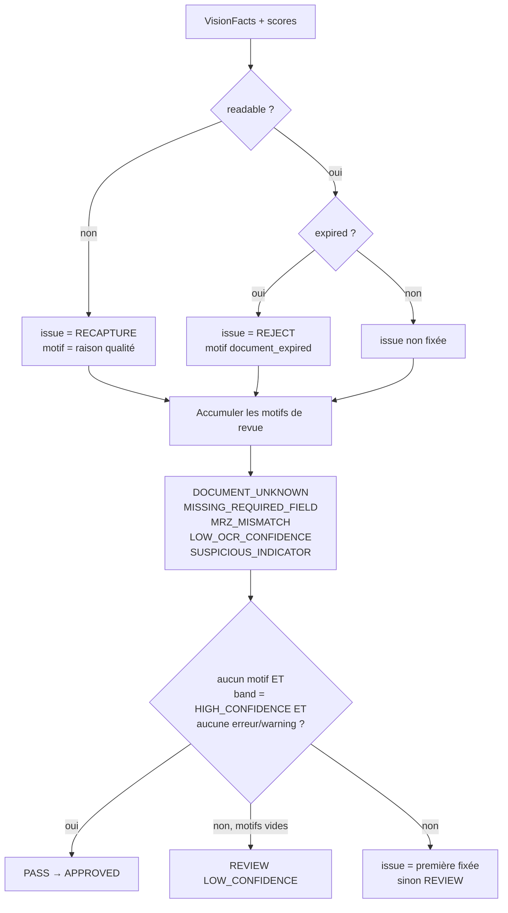
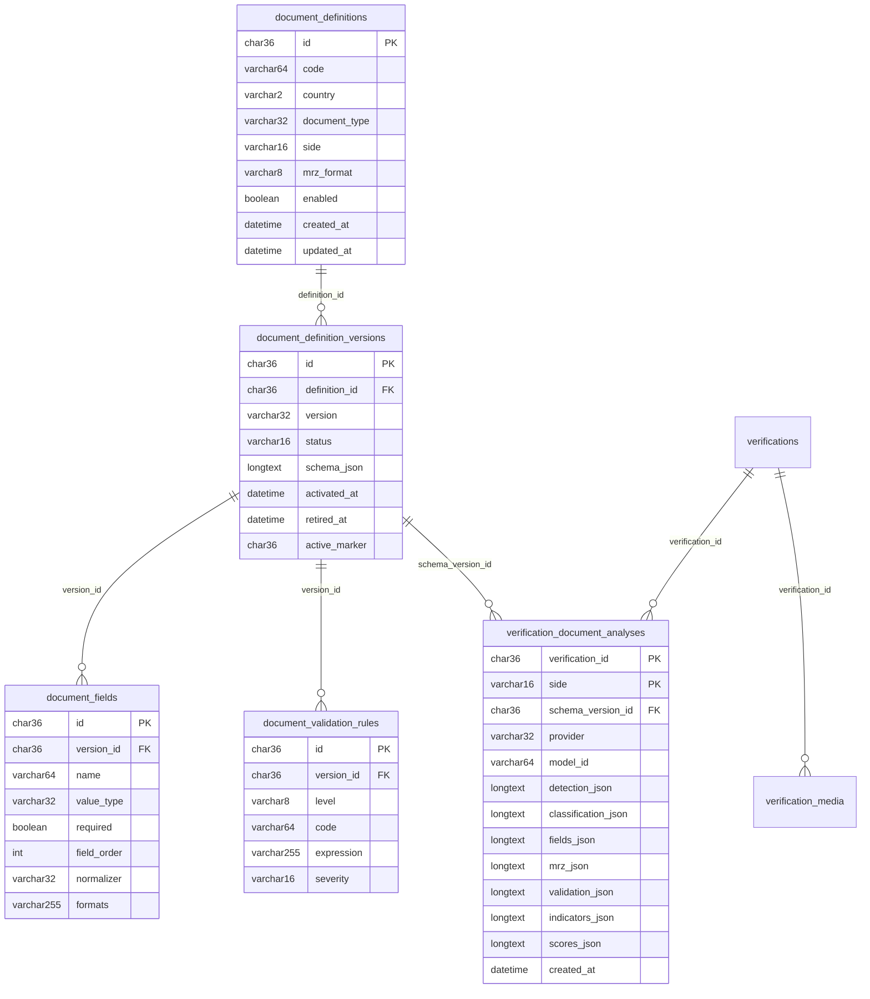

# Spécification détaillée — Module Document IA

**Plateforme :** Recogniz-Me  
**Module :** Document IA (analyse vision d’une pièce d’identité)  
**Version du document :** 1.0  
**Date :** 9 octobre 2026  
**Statut :** spécification **d’état livré** — décrit le comportement du code au 9 octobre 2026 (pipeline `vision-1`). Les écarts avec le cahier des charges sont listés au §12.  
**Périmètre code :** `api/` (Spring Boot 3.4 / Java 17), `web/flow` (capture applicant), `web/console` (lecture de la fiche).

**Documents liés :**
- [`cahier-des-charges-document-ia.md`](./cahier-des-charges-document-ia.md) — contrat cible (le *quoi*, §1–§19)
- [`roadmap-implementation-document-ia.md`](./roadmap-implementation-document-ia.md) — ordre de construction V0–V9 (statuts en retard sur le code, voir §12)
- [`../MVP/specification-m4-capture-idv-stub.md`](../MVP/specification-m4-capture-idv-stub.md) — flow hébergé, machine à états, ports, fiche
- [`../MVP/specification-m5-aws-live-webhook.md`](../MVP/specification-m5-aws-live-webhook.md) — décision live et webhook `verification.completed`
- [`../specs/specification-fonctionnelle-idv.md`](../specs/specification-fonctionnelle-idv.md) — métier IDV

Ce document est la référence **détaillée** du module : acteurs, cas d’utilisation, workflows étape par étape, modèle de données, contrats d’interface, règles de gestion numérotées (`RG-…`), configuration, exigences non fonctionnelles et critères d’acceptation. En cas de conflit métier, le cahier des charges prime ; en cas de conflit sur le **comportement réel**, ce document fait foi tant que le code n’a pas changé (§12 trace chaque écart).

---

## Sommaire

1. [Objet et périmètre](#1-objet-et-périmètre)
2. [Acteurs et glossaire](#2-acteurs-et-glossaire)
3. [Architecture](#3-architecture)
4. [Cas d’utilisation](#4-cas-dutilisation)
5. [Workflows détaillés](#5-workflows-détaillés)
6. [Modèle de données](#6-modèle-de-données)
7. [Contrats d’interface](#7-contrats-dinterface)
8. [Règles de gestion](#8-règles-de-gestion)
9. [Configuration](#9-configuration)
10. [Exigences non fonctionnelles](#10-exigences-non-fonctionnelles)
11. [Tests et critères d’acceptation](#11-tests-et-critères-dacceptation)
12. [Écarts, limites et points ouverts](#12-écarts-limites-et-points-ouverts)
13. [Annexes](#13-annexes)

---

## 1. Objet et périmètre

### 1.1 Objet

Le module Document IA **lit une pièce d’identité à partir d’une photo** et rend une **décision explicable** (`APPROVED`, `DECLINED`, `REVIEW`, ou demande de nouvelle capture) avec des champs normalisés, des scores recalculés et des motifs.

Principe directeur : **le modèle de vision lit, Java vérifie.**

| Responsabilité | Porteur |
|---|---|
| Voir la pièce, classer, transcrire les champs, signaler des anomalies visibles | Modèle de vision (LLM multimodal) |
| Qualité d’image mesurée, schéma attendu, normalisation, dates, MRZ, scores, décision | **Code Java déterministe** |
| Vérité sur « quels champs attendre » | **Registre de schémas** en base (jamais le prompt codé en dur) |

Le modèle ne produit **jamais** : de valeur normalisée, de chiffre de contrôle MRZ, de score global, de statut de validation ni de décision. Tout champ de ce type présent dans sa réponse est **ignoré** (RG-VIS-05).

### 1.2 Périmètre livré

| Domaine | Contenu livré |
|---|---|
| Banc (lab) | `GET /v1/document-ia/catalog`, `POST /v1/document-ia/analyze` (image réelle, appel vision), `POST /v1/document-ia/fixtures/{name}` (rejeu sans vision) — `until` par palier |
| Pipeline `vision-1` | Contrôle qualité → prompt depuis le catalogue → vision (2 essais) → parseur strict → normalisation L1–L3 → MRZ L4 → indicateurs L6 → scores → décision |
| Registre de schémas | Tables `document_definitions`, `_versions`, `document_fields`, `document_validation_rules` ; cycle `DRAFT → ACTIVE → RETIRED` ; validation à l’activation ; langage d’expression L3 fermé |
| Intégration live | `HostedFlowService` : recto, verso conditionnel, rejeu des analyses persistées, biométrie, décision `vision-1` |
| Sandbox | Intégration `test` : `StubDocumentAi`, **zéro appel vision** |
| Fournisseurs | `fake` (fixture), `unavailable` (panne simulée), `openai` (`gpt-4.1-mini` par défaut) |
| Documents seedés | Permis du Québec (recto + verso), passeport TD3 (spécimen ICAO `UT`), résident permanent du Canada (recto + verso TD1) |

### 1.3 Hors périmètre

| Domaine | Statut |
|---|---|
| Amazon Textract / `ocr_analyze_id` | Classes présentes dans le dépôt pour l’ancien chemin M5 ; **non utilisées** par `vision-1` |
| Catalogue CM / FR (CNI, passeports réels, titres de séjour) | Roadmap V9, non livré |
| Revue humaine d’une analyse (console opérateur Document IA) | Non livrée ; aucune route de lecture d’une analyse persistée |
| API REST d’administration du registre (création / activation / retrait de version) | Non livrée ; l’activation est un appel de service (`SchemaRegistry.activate`) |
| Détection d’authenticité ML (SageMaker, classifieur propriétaire) | Hors module |
| Liveness / comparaison de visage | Module biométrique distinct (`BiometricAiPort`) ; consommé par la décision finale uniquement |

### 1.4 Invariants à ne pas casser

1. Un **sandbox** (`ky_test_`) ne déclenche jamais d’appel vision (RG-SBX-01).
2. Le contenu lu (texte brut, zones, image) n’est **jamais journalisé** (RG-SEC-03).
3. La décision est **recalculée en Java** ; la confiance brute du modèle n’est jamais la décision (RG-SCO-01).
4. Une analyse persistée **fige** la version de schéma utilisée (RG-PER-04).
5. Isolation multi-organisation : l’intégration vient de la clé API / du jeton hébergé, jamais du corps de requête (RG-ACC-03).

---

## 2. Acteurs et glossaire

### 2.1 Acteurs

| Acteur | Rôle | Identification |
|---|---|---|
| **Applicant** | Photographie sa pièce (recto, éventuellement verso) puis son selfie | Jeton d’URL hébergée (`/flow/{token}`) — pas de compte |
| **Backend client** | Crée la session et reçoit le webhook ; peut appeler le banc avec une clé `ky_live_` | Bearer `ky_live_` / `ky_test_` |
| **Développeur / Intégrateur** | Utilise le banc pour mesurer la lecture sur ses images | Bearer `ky_live_` (le banc refuse `ky_test_`) |
| **Opérateur console** | Lit la fiche de vérification (identité extraite, motifs) | Cookie `rm_session` |
| **Équipe Recogniz-Me (admin schémas)** | Ajoute / active des versions de pièce | Accès base / déploiement (pas d’API) |
| **Fournisseur vision** | Modèle multimodal externe | Clé de configuration `kyc.document-ia.openai-api-key` |
| **Système** | Scheduler webhook, audit | — |

### 2.2 Glossaire

| Terme | Définition |
|---|---|
| **Définition** (`document_definitions`) | Une pièce **pour un côté** : couple unique `(code, side)` ; porte pays, type, format MRZ, `enabled` |
| **Version de schéma** | Édition imprimée d’une définition (`2024`, `2015`…) ; contient champs et règles |
| **Édition** (`SchemaEdition`) | Vue chargée en mémoire d’une version : champs, types, formats, règles |
| **Side** | `FRONT` ou `BACK` (côté du schéma) ; `captureSide` = côté **photographié** dans le flow |
| **Indicateur** | Signal d’anomalie : posé par le modèle (liste fermée) ou par le serveur |
| **Niveau de validation** | L1 format, L2 présence, L3 cohérence entre champs, L4 MRZ, L5 réservé (même mécanique que L3), L6 indicateurs |
| **Issue métier** | `PASS`, `REVIEW`, `REJECT`, `RECAPTURE` — décision du pipeline avant mappage vers `VerificationDecision` |
| **Rules version** | `vision-1` pour tout le chemin vision (stub sandbox : `m4-1`) |
| **Fixture** | JSON de réponse modèle figé dans `src/main/resources/document-ia/` pour rejouer sans vision |

---

## 3. Architecture

### 3.1 Composants



### 3.2 Responsabilités par classe

| Classe | Package | Responsabilité |
|---|---|---|
| `DocumentIaController` | `controllers` | Routes `/v1/document-ia/*`, exige un Bearer |
| `DocumentIaLabService` | `services` | Orchestre le pipeline par palier (`until`), `decideImage` pour le flow live, `recapture`, `visionFailure` |
| `ImageQualityGate` | `services.documentia` | Mesures serveur : taille, luminosité, netteté |
| `VisionPrompt` | `services.documentia` | Construit le prompt **depuis le catalogue actif** |
| `VisionAttempts` | `services.documentia` | Au plus 2 appels fournisseur + parse ; code d’échec |
| `DocumentAnalysisParser` | `services.documentia` | Parse strict du JSON modèle, classification, filtrage des champs |
| `FieldNormalizer` | `services.documentia` | L1–L3 : valeurs normalisées, clés de comparaison, règles |
| `MrzEngine` | `services.documentia` | Parse TD1/TD2/TD3, recalcul des chiffres de contrôle, recoupement |
| `DocumentValidator` | `services.documentia` | Agrège issues, indicateurs et `VisionFacts` |
| `ConfidenceScorer` | `services.documentia` | Scores et bande de confiance |
| `IdvDecisionEngine` | `services` | `decideVision` : issue, décision, motifs, signaux |
| `SchemaRegistry` | `services.documentia` | Catalogue, éditions, activation, seeds |
| `DocumentLiveView` | `services.documentia` | Adapte la réponse du banc en résultat live (`DocumentSignals`, identité, verdict) |
| `DocumentAnalysisStore` / `DocumentAnalysisBuffer` | `services` | Persistance idempotente par `(verification, side)` et rejeu |
| `VisionDocumentAi` | `adapters` | Façade du flow live (port `VisionDocumentPort` + `DocumentLiveView`) |
| `StubDocumentAi` | `adapters` | Sandbox : 3 scénarios figés |

### 3.3 Ports et adaptateurs

| Port | Adaptateur | Sélection |
|---|---|---|
| `VisionDocumentPort.complete(byte[] image, String mediaType, String prompt) : String` | `FakeVisionDocument` | `kyc.document-ia.provider=fake` (défaut si absent) |
| | `OpenAiVisionDocument` | `provider=openai` |
| | `UnavailableVisionDocument` | `provider=unavailable` |
| `DocumentAiPort` (sandbox) | `StubDocumentAi` | bean `stubDocumentAi` |

Le bean live `liveDocumentAi` (`VisionDocumentAi`) est défini dans `IdvStoreConfig`.

### 3.4 Routage live / sandbox

| Intégration | Document | Décision | `rules_version` |
|---|---|---|---|
| `test` (`ky_test_`) | `StubDocumentAi` + `sandbox_scenario` | moteur stub | `m4-1` |
| `live` (`ky_live_`) | Pipeline vision (ce module) | `decideVision` | `vision-1` |

---

## 4. Cas d’utilisation

Format : **Acteur · Préconditions · Déclencheur · Scénario nominal · Alternatives · Postconditions · Règles**.

### 4.1 Vue d’ensemble

| ID | Cas d’utilisation | Acteur principal | Statut |
|---|---|---|---|
| UC-01 | Consulter le catalogue des schémas actifs | Développeur | Livré |
| UC-02 | Analyser une image au banc, par palier | Développeur | Livré |
| UC-03 | Rejouer une fixture sans fournisseur | Développeur | Livré |
| UC-04 | Capturer et analyser le recto en session live | Applicant | Livré |
| UC-05 | Capturer et analyser le verso (si requis) | Applicant | Livré |
| UC-06 | Décider une session live (document + visage) | Système | Livré |
| UC-07 | Exécuter une session sandbox | Applicant / Backend client | Livré |
| UC-08 | Ajouter et activer une version de schéma | Équipe Recogniz-Me | Partiel (service, sans API) |
| UC-09 | Rejouer une analyse persistée | Système | Livré |
| UC-10 | Relire l’analyse d’une vérification (revue humaine) | Opérateur console | **Non livré** |

### UC-01 — Consulter le catalogue

| Élément | Contenu |
|---|---|
| Acteur | Développeur |
| Préconditions | Banc activé (`lab-enabled=true`) ; Bearer valide |
| Déclencheur | `GET /v1/document-ia/catalog` |
| Nominal | 1. Le serveur vérifie le Bearer. 2. Le serveur lit les versions `ACTIVE`. 3. Il renvoie, par schéma : `schemaVersionId`, `code`, `country`, `documentType`, `side`, `version`, `issuingJurisdiction`, `fields[{name, required, hint}]`. |
| Alternatives | A1 — banc désactivé → `404`. A2 — Bearer absent/invalide → `401`. |
| Postconditions | Aucune écriture. Une clé `ky_test_` **peut** lire le catalogue (pas d’appel vision). |
| Règles | RG-ACC-01, RG-ACC-02, RG-REG-05 |

### UC-02 — Analyser une image au banc

| Élément | Contenu |
|---|---|
| Acteur | Développeur |
| Préconditions | Banc activé ; clé **`ky_live_`** ; image JPEG/PNG lisible |
| Déclencheur | `POST /v1/document-ia/analyze` (multipart `file`, `until` optionnel) |
| Nominal | 1. Contrôle Bearer et mode `live`. 2. Validation de `until`. 3. Mesure de qualité. 4. Si lisible et `until ≥ vision` : prompt, appel fournisseur (≤ 2 essais), parse. 5. Selon `until` : normalisation, MRZ, validation, décision. 6. Réponse enveloppe `vision-1` avec `stoppedAt`. |
| Alternatives | A1 — clé `ky_test_` → `403 sandbox_no_vision`, **0 appel**. A2 — `until` inconnu → `400`. A3 — fichier absent/vide → `400` (`file: required`). A4 — octets non décodables → `400` (`file: invalid`). A5 — image illisible (qualité) : `until=decide` → décision `RECAPTURE` ; sinon enveloppe `stoppedAt=quality`, **vision non appelée**. A6 — 2 échecs fournisseur → `200`, `providerCalled=true`, `indicators=["provider_unavailable"]` (ou `["invalid_model_json"]`) ; avec `until=decide` : décision `REVIEW`. |
| Postconditions | Aucune `Verification` créée, aucun débit de crédit, aucune persistance. |
| Règles | RG-ACC-*, RG-QUA-*, RG-VIS-*, RG-SBX-01, RG-SEC-03 |

### UC-03 — Rejouer une fixture

| Élément | Contenu |
|---|---|
| Acteur | Développeur |
| Préconditions | Banc activé ; Bearer valide (test ou live) |
| Déclencheur | `POST /v1/document-ia/fixtures/{name}?until=…` |
| Nominal | Le serveur charge `document-ia/{name}.json`, le parse comme une réponse modèle, puis exécute les paliers demandés **sans** qualité ni fournisseur (`providerCalled=false`). |
| Alternatives | A1 — nom invalide ou fixture absente → `404`. A2 — JSON hors contrat → `422 invalid_model_json`. A3 — `until` invalide → `400`. |
| Postconditions | Aucune écriture. Autorisé pour `ky_test_` (aucun fournisseur). |
| Règles | RG-VIS-04, RG-ACC-01 |

### UC-04 — Capturer et analyser le recto (live)

| Élément | Contenu |
|---|---|
| Acteur | Applicant |
| Préconditions | Session `live` ; consentement accepté ; statut ∈ {`PENDING_APPLICANT`, `DOCUMENT`, `RECAPTURE_REQUESTED`} |
| Déclencheur | Upload du recto puis « terminé » (`documentComplete`) |
| Nominal | Voir [WF-2b](#wf-2b--capture-document-détail-pas-à-pas) : jeton d’upload (TTL 5 min) → dépôt → garde média (JPEG/PNG, ≤ 10 Mio, côté court ≥ 720 px) → analyse **immédiate** du recto (`captureSide=FRONT`) → analyse **persistée** si acceptée → verso exigé si recto `APPROVED` et côté `BACK` au catalogue → sinon `SELFIE`. |
| Alternatives | A1 — garde média refuse → `RECAPTURE_REQUESTED`, essai compté, objet supprimé. A2 — 3ᵉ échec → `DECLINED` `capture_attempts_exceeded`. A3 — fournisseur indisponible à la capture → pas de ligne persistée, pas de verso demandé ; l’analyse sera refaite à la décision (UC-06). A4 — recto accepté mais non `APPROVED` (ex. `REVIEW`) → pas de verso ; la session continue vers le selfie et se terminera avec la décision du recto. |
| Postconditions | Média stocké ; ligne `verification_document_analyses` `(id, FRONT)` si acceptée. |
| Règles | RG-FLX-*, RG-PER-* |

### UC-05 — Capturer et analyser le verso

| Élément | Contenu |
|---|---|
| Acteur | Applicant |
| Préconditions | `document_back_required=true` ; recto traité |
| Déclencheur | Upload du verso (`MediaKind.DOCUMENT_BACK`) puis « terminé » |
| Nominal | Même enchaînement que UC-04 avec `captureSide=BACK` ; analyse persistée sous `(id, BACK)`. Puis statut `SELFIE`. |
| Alternatives | Mêmes que UC-04. |
| Postconditions | `(id, BACK)` persistée si acceptée. |
| Règles | RG-FLX-04, RG-FLX-05 |

### UC-06 — Décider une session live

| Élément | Contenu |
|---|---|
| Acteur | Système (après le selfie) |
| Préconditions | Selfie accepté ; statut `SELFIE` → `PROCESSING` |
| Nominal | Voir [WF-3](#wf-3--décision-dune-session-live). Résultat : `APPROVED`, `DECLINED` ou `REVIEW`, motifs, `rules_version=vision-1`, `extracted_identity`, audit `verification.completed`, webhook. |
| Alternatives | A1 — recto non `APPROVED` → décision du document, **pas** de comparaison de visage. A2 — verso requis non persisté → `REVIEW provider_unavailable`. A3 — `ProviderUnavailableException` → `REVIEW provider_unavailable`. |
| Postconditions | `Verification` en état terminal ; signaux persistés ; webhook en file. |
| Règles | RG-DEC-*, RG-FLX-06 |

### UC-07 — Session sandbox

| Élément | Contenu |
|---|---|
| Acteur | Applicant / Backend client |
| Préconditions | Intégration `test` |
| Nominal | `StubDocumentAi.analyze` renvoie des signaux figés selon `sandbox_scenario` ; `stubBiometricAi` évalue le visage ; `engine.decide(scenario)` tranche. Aucune vision, aucune analyse persistée (`askForBack` faux). Règles `m4-1`. |
| Scénarios | Document stub : `approved` (défaut) → passeport FR fictif valide ; `expired` → pièce expirée ; `unsupported` → type `unknown` / pays `ZZ`. Moteur stub (`decide`) : `approved`, `unsupported`, `expired`, `liveness_fail`, `mismatch` (`face_match_fail`), `review` (`mrz_unavailable`). |
| Règles | RG-SBX-* |

### UC-08 — Ajouter et activer une version de schéma

| Élément | Contenu |
|---|---|
| Acteur | Équipe Recogniz-Me |
| Préconditions | Définition et version `DRAFT` existent (migration Flyway ou seed) |
| Nominal | Voir [WF-6](#wf-6--activation-dune-version-de-schéma). |
| Alternatives | A1 — version non `DRAFT` → `409 invalid_status`. A2 — schéma invalide → erreur de validation, la version **reste `DRAFT`**. |
| Postconditions | Version `ACTIVE`, champs et règles recopiés dans leurs tables ; visible au catalogue **immédiatement**. |
| Règles | RG-REG-* |

### UC-09 — Rejouer une analyse persistée

| Élément | Contenu |
|---|---|
| Acteur | Système (dans UC-06) |
| Nominal | Si `(verification, side)` existe : reconstruire le résultat depuis les JSON stockés **sans** appel fournisseur ni relecture du registre actif. |
| Règles | RG-PER-03, RG-PER-04 |

### UC-10 — Relire l’analyse d’une vérification (cible)

Non livré. Prévu : route de lecture console exposant champs normalisés, issues, indicateurs et scores d’une `verification_document_analyses`, plus action de revue (`applyReview`). Les données nécessaires sont déjà persistées (§6.4).

---

## 5. Workflows détaillés

### WF-1 — Pipeline d’analyse `vision-1`

Le pipeline est séquentiel ; chaque palier est atteignable via `until` (ordre : `quality < parse < vision < normalize < mrz < validate < decide`).



#### Étape P1 — Contrôle qualité serveur

| # | Action | Détail |
|---|---|---|
| 1 | Décoder l’image (`ImageIO`) | Échec ou octets vides → `400` `file: invalid` |
| 2 | Calculer `tooSmall` | `min(largeur, hauteur) < 480` |
| 3 | Échantillonner | Pas = `round(côté_court / 320)`, minimum 1 |
| 4 | Luminance par pixel | `0,299·R + 0,587·G + 0,114·B` |
| 5 | `lowLight` / `overexposed` | moyenne `< 22` / `> 250` |
| 6 | `blur` | moyenne de `|centre − voisin|` (4 voisins, divisée par 4) `< 4` |
| 7 | `readable` | `!tooSmall && !lowLight && !overexposed && !blur` ; `unreadable = !readable` |
| 8 | `reason` | Premier vrai dans l’ordre `TOO_SMALL`, `LOW_LIGHT`, `OVEREXPOSED`, `IMAGE_TOO_BLURRY` |

Les autres drapeaux (`glare`, `cropped`, `partiallyVisible`, `multipleDocuments`, `tilted`) valent `false` côté serveur. Si illisible : fin du pipeline (**aucun** appel fournisseur, aucun coût).

#### Étape P2 — Prompt

Le prompt est construit par `VisionPrompt.fromCatalog(schémas actifs, captureSide)` :
1. Consigne : un seul JSON, `classification.version` = jeton de version seul (ex. `2024`), noms de champs copiés de la liste du côté choisi.
2. Pour **chaque** schéma actif : `code`, `country`, `documentType`, `side`, `version`, `issuingJurisdiction` (si présente), puis `fields` avec `required|optional` et `hint`.
3. Si `captureSide` connu (flow live) : `Capture side: FRONT|BACK` et « utiliser uniquement les champs listés pour ce côté ».

Le message système fournit en plus la forme de la réponse (énumération `detection`, exemple), interdit de calculer des chiffres de contrôle et de renommer les libellés imprimés.

#### Étape P3 — Appel vision (`VisionAttempts`)

| # | Action |
|---|---|
| 1 | Essai 1 : `port.complete(image, mediaType, prompt)` puis `parser.parse(raw)` |
| 2 | `ProviderUnavailableException` → code `provider_unavailable` ; `InvalidModelJsonException` → code `invalid_model_json` |
| 3 | Essai 2 identique si l’essai 1 a échoué |
| 4 | Succès → `(raw, parsed)` ; deux échecs → `failureCode` du **dernier** échec |
| 5 | Échec final : enveloppe `stoppedAt=vision`, `providerCalled=true`, `indicators=[failureCode]` ; si `until=decide` : décision `REVIEW` (`reasons=[failureCode]`, `rulesVersion=vision-1`) |

Au plus **2 requêtes fournisseur par image** (RG-VIS-02).

#### Étape P4 — Parse strict et classification

1. **Contrat JSON** : `detection` obligatoire, dans `NO_DOCUMENT | DOCUMENT_PRESENT | PARTIALLY_VISIBLE | CROPPED | MULTIPLE_DOCUMENTS | TOO_SMALL | UNREADABLE` ; `quality`, `classification` : objets ; `zones`, `fields`, `indicators` : tableaux ; valeur d’un champ : chaîne, nombre ou booléen (convertis en texte). Toute autre forme → `InvalidModelJsonException`.
2. **Qualité modèle** : drapeaux lus ; `severe = blur ∨ glare ∨ cropped ∨ partiallyVisible ∨ multipleDocuments ∨ tooSmall ∨ lowLight ∨ overexposed` ; `readable = (detection == DOCUMENT_PRESENT) ∧ ¬severe` ; `documentDetected = detection ≠ NO_DOCUMENT` (le booléen `documentDetected` du modèle est ignoré). **Ces valeurs sont informatives** (voir §12, E-01).
3. **Classification** (RG-CLA-*) : recherche des schémas actifs et activés par `code` ; sinon `UNKNOWN`.
4. **Champs** : seuls les noms présents dans le schéma retenu sont gardés ; `normalizedValue`, `validationStatus`, `checkDigit` et toute clé hors contrat sont écartés.
5. **Zones** : `boundingBox` conservée seulement si les 4 composantes sont dans `[0, 1]`.
6. **Indicateurs modèle** : liste fermée (RG-VAL-04).

#### Étape P5 — Normalisation L1–L3

Voir RG-NOR-*. Entrée : champs bruts + édition ; sortie : `NormalizedField[]` et issues L1/L2/L3.

#### Étape P6 — MRZ L4

Voir WF-4 et RG-MRZ-*.

#### Étape P7 — Validation et faits

`DocumentValidator` fusionne les issues, ajoute les indicateurs modèle comme issues `L6 WARNING`, et calcule `VisionFacts` : `readable`, `expired`, `unknown`, `missingRequired`, `mrzFailed`, `lowOcr`, `suspicious`, `hasError`, `hasWarning`.

#### Étape P8 — Scores

Voir RG-SCO-*.

#### Étape P9 — Décision

Voir WF-5 et RG-DEC-*.

#### Paliers `until` et contenu de la réponse

| `until` | `stoppedAt` | Blocs renseignés | Appel vision |
|---|---|---|---|
| (absent), `vision` | `vision` | `quality`, `rawModel`, `parsed`, `schemaVersionId` | oui (si lisible) |
| `quality` | `quality` | `quality` | non |
| `parse` | `parse` (fixture) ou `quality` (image) | `parsed` | non |
| `normalize` | `normalize` | + `fields`, `validation` | oui (image) / non (fixture) |
| `mrz` | `mrz` | + `mrz` | idem |
| `validate` | `validate` | + `indicators`, `scores` | idem |
| `decide` | `decide` | + `decision` | idem |

Rappel : sur une **fixture**, `quality` et `vision` ne s’appliquent pas (la fixture est traitée comme réponse modèle) ; sur une **image**, `parse` équivaut à `quality` (le parse n’existe qu’après l’appel).

---

### WF-2 — Parcours live d’une session (vue complète)



#### Machine à états de la vérification



États annulables (`CANCELABLE`) : `CREATED`, `PENDING_CONSENT`, `PENDING_APPLICANT`, `DOCUMENT`, `RECAPTURE_REQUESTED`, `SELFIE`. États terminaux : `REVIEW`, `APPROVED`, `DECLINED`, `EXPIRED`, `CANCELLED`.

---

### WF-2b — Capture document (détail pas à pas)

| # | Étape | Acteur | Détail et résultat |
|---|---|---|---|
| 1 | Demande d’upload | Applicant | `documentUpload(token)` : exige le consentement et un statut ∈ {`PENDING_APPLICANT`, `DOCUMENT`, `RECAPTURE_REQUESTED`}. Si c’est le tour du verso (`document_back_required` et recto accepté, verso absent) ⇒ `kind=DOCUMENT_BACK` ; sinon, si un recto est déjà accepté ⇒ `409 invalid_status` ; sinon `kind=DOCUMENT` |
| 2 | Création de l’essai | Système | Compte les essais du même `kind` : `≥ 3` ⇒ `409 invalid_status` ; sinon crée un `verification_media` (`attempt = n+1`), clé `org/{org}/verifications/{id}/{kind}/{attempt}`, et une URL signée `image/jpeg` valable **5 min** ; un premier recto fait passer `PENDING_APPLICANT → DOCUMENT` |
| 3 | Dépôt binaire | Applicant | Envoi de l’image vers l’URL signée (stockage objet) |
| 4 | Fin de capture | Applicant | `documentComplete(attempt, side?)` : `side="back"` force le verso ; l’objet doit exister (sinon `400 object: missing`) ; l’essai doit être `PENDING` (sinon `409`) |
| 5a | Garde média refuse | Système | `MediaQuality.acceptableDocument` faux (JPEG/PNG, ≤ 10 Mio, côté court ≥ 720 px) : essai rejeté, objet **supprimé** ; si 3ᵉ échec ⇒ `DECLINED` `capture_attempts_exceeded`, jeton hébergé révoqué, audit `verification.declined` ; sinon `RECAPTURE_REQUESTED` |
| 5b | Garde média accepte | Système | Essai `accepted` (type MIME détecté, taille) ; suite |
| 6 | Recto, intégration `live` | Système | `askForBack` : `analyzeCapture(octets, "FRONT")` (appel vision ici, pas à la décision) puis `saveAccepted(FRONT)` si la vue est **acceptée** (idempotent) |
| 7 | Verso requis ? | Système | Si la vue est acceptée, que sa décision est `APPROVED` **et** que le catalogue a un côté `BACK` pour le même `code` ⇒ `document_back_required=true` ; la réponse est `accepted=true` avec l’étape suivante « verso », statut inchangé |
| 8 | Fournisseur indisponible à l’étape 6 | Système | `ProviderUnavailableException` journalisée (`provider_unavailable`) ⇒ pas de verso demandé, pas de ligne persistée ; la décision refera l’analyse (UC-06) |
| 9 | Verso (tour du verso) | Système | Après acceptation du média `DOCUMENT_BACK` : `storeBack` ⇒ `analyzeCapture(octets, "BACK")` puis `saveAccepted(BACK)` ; exception fournisseur journalisée et ignorée |
| 10 | Transition | Système | Recto sans verso requis, ou verso traité ⇒ `markSelfie` (`SELFIE`) |
| 11 | Intégration `test` | Système | Aucune analyse à cette étape (`askForBack` rend `false`) ; transition directe vers `SELFIE` |

---

### WF-3 — Décision d’une session live

| # | Étape | Détail |
|---|---|---|
| 1 | Statut → `PROCESSING` | `markProcessing` |
| 2 | Récupérer le recto | `replayOrAnalyze` : si `(id, FRONT)` existe → rejeu (0 appel) ; sinon analyse du média stocké sans `captureSide` (≤ 2 requêtes fournisseur), puis `saveAccepted(FRONT)`. Si la décision du pipeline est `null` (`RECAPTURE`), elle devient `REVIEW` avec les mêmes motifs |
| 3 | Recto ≠ `APPROVED` | Terminer : décision du document (`DECLINED` ou `REVIEW`), **sans** comparaison de visage |
| 4 | Verso requis ? | Si `document_back_required` : rejeu de `(id, BACK)` ; absent → `REVIEW provider_unavailable` |
| 5 | Verso ≠ `APPROVED` | Terminer avec la décision du verso (`null` → `REVIEW`), ses motifs, et l’identité du **recto** |
| 6 | Biométrie | `liveBiometricAi.evaluate(document, selfie)` évalue le selfie contre le portrait de la session |
| 7 | `applyFace` | Remplace le résultat document par le résultat visage, en gardant l’identité (voir RG-DEC-08) |
| 8 | Persistance | `Verification.decide(decision, motifs JSON, "vision-1", identité JSON)` ; statut = décision |
| 9 | Signaux | Un signal par motif/contrôle du résultat final (pour un `APPROVED` : `liveness_pass`, `face_match_pass`) |
| 10 | Audit | Événement `verification.completed` |
| 11 | Webhook | Mise en file de `verification.completed` (sans média) |

Si `ProviderUnavailableException` survient à l’étape 2 ou 4 : `REVIEW provider_unavailable`.

---

### WF-4 — Moteur MRZ

Actif uniquement si `mrzFormat ∈ {TD1, TD2, TD3}` de la définition.

| # | Étape | Détail |
|---|---|---|
| 1 | Localiser le bloc | Valeur du champ de type `MRZ`, sinon `rawText`. Lignes de largeur exacte (TD1 : 3 × 30, TD2 : 2 × 36, TD3 : 2 × 44) sur l’alphabet `A-Z 0-9 <` ; à défaut, texte compacté de longueur `largeur × lignes` |
| 2 | Bloc introuvable | Issue `L4 mrz_unavailable` (`WARNING`), `status=UNAVAILABLE`, `mrzScore=0,0` |
| 3 | Parser | Découpage par format ; extraction numéro, naissance, expiration, sexe, nationalité, noms |
| 4 | Recalculer | Pondération `7-3-1` ; chiffres : numéro de document, naissance, expiration, donnée optionnelle (TD3), **composite** |
| 5 | Comparer imprimé / calculé | Contrôle invalide : accepter la lecture corrigée **seulement si une unique** substitution d’un caractère (`0↔O`, `1↔I`, `2↔Z`, `5↔S`, `8↔B`) rétablit tous les contrôles ; aucune ou plusieurs candidates → échec |
| 6 | Échec | Issue `L4 mrz_check_digit_failed` (`WARNING`), `status=FAILED`, `mrzScore=0,4` ; **pas** de recoupement |
| 7 | Succès | Recouper chaque champ visuel `VALID` avec la MRZ (`lastName`, `firstName`, `documentNumber`, `dateOfBirth`, `expirationDate`, `sex`, `nationality`) via `comparisonKey` |
| 8 | Concordance | `source` du champ devient `VISUAL_AND_MRZ` |
| 9 | Divergence | Champ `MISMATCH`, issue `L4 mrz_mismatch` (`WARNING`), `status=MISMATCH`, `mrzScore=0,4` |
| 10 | Tout concorde | `status=VALID`, `mrzScore=1,0` |

Siècle : naissance `20yy` si non postérieure à aujourd’hui, sinon `19yy` ; expiration toujours `20yy`.

---

### WF-5 — Décision `decideVision` (`vision-1`)



Voir RG-DEC-* pour l’ordre exact et le mappage.

---

### WF-6 — Activation d’une version de schéma

| # | Étape | Détail |
|---|---|---|
| 1 | Charger la version | Absente → `404` |
| 2 | Statut | Doit être `DRAFT`, sinon `409 invalid_status` |
| 3 | Charger la définition | Absente → `404` |
| 4 | Lire `schema_json` | Doit être un objet JSON |
| 5 | Cohérence avec la définition | `code`, `country`, `documentType`, `side`, `version`, `mrzFormat` du JSON **égaux** à ceux de la définition/version, sinon `mismatch` |
| 6 | Champs | Tableau non vide ; objets ; noms uniques ; `type` dans `FieldValueType` ; champ `DATE` ⇒ `formats` non vide |
| 7 | MRZ | Si `mrzFormat ≠ NONE` ⇒ un champ de type `MRZ` est obligatoire |
| 8 | Règles | Chaque règle : `level ∈ {L3, L5}`, `severity ∈ {ERROR, WARNING}`, `code`, `expression` non vides |
| 9 | Expression | Forme unique `champ OP champ` avec `OP ∈ {<, <=, >, >=}` ; **les deux champs de type `DATE`** de la version |
| 10 | Écriture | Suppression puis recréation de `document_fields` et `document_validation_rules` depuis le JSON |
| 11 | Activer | `status=ACTIVE`, `activated_at`, `retired_at=null`, `active_marker=id` ; `definition.touch` |
| 12 | Échec à l’étape 3-9 | La version **reste `DRAFT`** (transaction annulée) |

L’activation **ne retire pas** les autres versions actives de la définition (RG-REG-04).

---

## 6. Modèle de données

### 6.1 Diagramme



### 6.2 Registre de schémas

#### `document_definitions` (V24, modifiée V29)

| Colonne | Type | Null | Description |
|---|---|---|---|
| `id` | CHAR(36) | non | UUID |
| `code` | VARCHAR(64) | non | Code stable envoyé au modèle (`QUEBEC_DRIVER_LICENSE`) |
| `country` | VARCHAR(2) | non | ISO alpha-2 **de la pièce** |
| `document_type` | VARCHAR(32) | non | `DRIVING_LICENSE`, `PASSPORT`, `RESIDENCE_PERMIT`, … |
| `side` | VARCHAR(16) | non | `FRONT` \| `BACK` |
| `mrz_format` | VARCHAR(8) | non | `NONE`, `TD1`, `TD2`, `TD3` |
| `enabled` | BOOLEAN | non | Définition éligible à la classification |
| `created_at`, `updated_at` | DATETIME(6) | non | |

Contrainte : `UNIQUE (code, side)` (`uq_document_definitions_code_side`, V29 ; l’unicité sur `code` seul de V24 a été supprimée pour permettre recto/verso).

#### `document_definition_versions` (V24, V25)

| Colonne | Type | Description |
|---|---|---|
| `id` | CHAR(36) | PK |
| `definition_id` | CHAR(36) | FK → `document_definitions` |
| `version` | VARCHAR(32) | Jeton imprimé (`2024`, `2015`) |
| `status` | VARCHAR(16) | `DRAFT`, `ACTIVE`, `RETIRED` |
| `schema_json` | LONGTEXT | Schéma complet (source d’activation) |
| `activated_at`, `retired_at` | DATETIME(6) | Horodatages |
| `active_marker` | CHAR(36) | = `id` quand `ACTIVE`, sinon `NULL` |

Contraintes : `UNIQUE (definition_id, version)` ; `UNIQUE (active_marker)`. Comme le marqueur est l’`id` de la version, **plusieurs versions `ACTIVE` d’une même définition peuvent coexister** (voir RG-REG-04).

#### `document_fields`

| Colonne | Description |
|---|---|
| `name` | Nom du champ (`UNIQUE (version_id, name)`) |
| `value_type` | `STRING`, `NAME`, `DATE`, `SEX`, `COUNTRY`, `NATIONALITY`, `DOCUMENT_NUMBER`, `ADDRESS`, `POSTAL_CODE`, `MRZ` |
| `required` | Champ obligatoire |
| `field_order` | Ordre d’affichage et de normalisation |
| `normalizer` | Nom indicatif (`ICAO_NAME`, `ISO_DATE`) |
| `formats` | Formats de date séparés par virgule (obligatoire pour `DATE`) ; motifs pour `POSTAL_CODE` |

#### `document_validation_rules`

| Colonne | Description |
|---|---|
| `level` | `L3` ou `L5` |
| `code` | Code d’issue émis si la règle se déclenche (`DOB_AFTER_ISSUE`) |
| `expression` | `champ OP champ`, opérateurs `<`, `<=`, `>`, `>=` sur deux champs `DATE` |
| `severity` | `ERROR`, `WARNING` |

Sémantique : la règle décrit la **violation** ; si l’expression est vraie sur deux dates `VALID`, l’issue `code` est ajoutée. Exemple : `dateOfBirth > dateOfIssue` ⇒ `DOB_AFTER_ISSUE`.

#### Structure de `schema_json`

```json
{
  "code": "QUEBEC_DRIVER_LICENSE",
  "country": "CA",
  "documentType": "DRIVING_LICENSE",
  "version": "2024",
  "side": "FRONT",
  "mrzFormat": "NONE",
  "issuingJurisdiction": "QC",
  "fields": [
    { "name": "dateOfBirth", "type": "DATE", "required": true,
      "normalizer": "ISO_DATE",
      "formats": ["yyyy-MM-dd", "yyyy/MM/dd", "dd/MM/yyyy", "MM/dd/yyyy"],
      "hint": "date labeled Date de naissance" }
  ],
  "rules": [
    { "level": "L3", "code": "DOB_AFTER_ISSUE",
      "expression": "dateOfBirth > dateOfIssue", "severity": "ERROR" }
  ]
}
```

`issuingJurisdiction` et `hint` vivent **uniquement** dans `schema_json` (pas de colonne dédiée) ; `hint` est reproduit dans le prompt.

### 6.3 Schémas livrés

Dernier état après V24–V31 ; identifiants fixes pour les tests (`SchemaRegistry` : constantes `*_ID`).

| Code | Side | Pays | Type | Version | MRZ | Champs (✱ = requis) |
|---|---|---|---|---|---|---|
| `QUEBEC_DRIVER_LICENSE` | FRONT | CA (`QC`) | `DRIVING_LICENSE` | 2024 | NONE | firstName✱, lastName✱, dateOfBirth✱, expirationDate✱, documentNumber✱, dateOfIssue, sex, address, licenseClass, conditions, mentions, referenceNumber, heightCm, eyeColor ; règle L3 `DOB_AFTER_ISSUE` |
| `QUEBEC_DRIVER_LICENSE` | BACK | CA (`QC`) | `DRIVING_LICENSE` | 2024 | NONE | barcode✱ (valeur `PRESENT`), classDescription, cardEdition |
| `PASSPORT_TD3` | FRONT | **UT** (spécimen ICAO) | `PASSPORT` | 2024 | TD3 | lastName✱, firstName✱, documentNumber✱, dateOfBirth✱, expirationDate✱, sex✱, nationality, mrz✱ |
| `CANADA_PERMANENT_RESIDENT` | FRONT | CA | `RESIDENCE_PERMIT` | 2015 | NONE | lastName✱, firstName✱, documentNumber✱ (ID No), dateOfBirth✱, expirationDate✱, sex, nationality |
| `CANADA_PERMANENT_RESIDENT` | BACK | CA | `RESIDENCE_PERMIT` | 2015 | TD1 | documentNumber✱ (PD), mrz✱, lastName, firstName, dateOfBirth, expirationDate, sex, nationality, placeOfLanding, residentSince, eyeColor, heightCm, countryOfBirth |

> Les schémas sont semés **deux fois** : migrations Flyway (production) et `SchemaRegistry.ensure*` (tests H2, Flyway désactivé). Toute modification doit être faite aux deux endroits (voir E-09).

### 6.4 Persistance des analyses

#### `verification_document_analyses` (V28, modifiée V29)

| Colonne | Type | Description |
|---|---|---|
| `verification_id` | CHAR(36) | PK (1/2), FK → `verifications` |
| `side` | VARCHAR(16) | PK (2/2), `FRONT` \| `BACK` (défaut `FRONT` pour l’existant) |
| `schema_version_id` | CHAR(36) | FK → `document_definition_versions`, nullable |
| `provider` | VARCHAR(32) | `vision_llm` |
| `model_id` | VARCHAR(64) | Modèle/fournisseur utilisé |
| `detection_json` | LONGTEXT | `{documentDetected, detection, quality}` — **drapeaux issus du modèle** |
| `classification_json` | LONGTEXT | `{code, country, issuingJurisdiction, documentType, version, side, confidence}` |
| `fields_json` | LONGTEXT | `NormalizedField[]` |
| `mrz_json` | LONGTEXT | `MrzReport` ou `null` |
| `validation_json` | LONGTEXT | `ValidationIssue[]` |
| `indicators_json` | LONGTEXT | Indicateurs (chaînes) |
| `scores_json` | LONGTEXT | `DocumentScores` |
| `created_at` | DATETIME(6) | Horodatage |

**Non persistés** : image, `rawText`, `zones`, réponse brute du modèle, qualité serveur (RG-PER-05).

#### Colonnes ajoutées à `verifications` (V29 et antérieures)

| Colonne | Rôle |
|---|---|
| `document_back_required` | BOOLEAN, `false` par défaut ; `true` quand un verso est exigé |
| `extracted_identity` | TEXT JSON : `first_name`, `last_name`, `birth_date`, `document_number`, `expiration_date`, `document_type`, `document_country`, `issuing_jurisdiction`, `document_code`, `schema_version` |
| `decision`, `decision_reasons`, `rules_version` | Résultat final (`rules_version=vision-1`) |

`verification_media.kind` : `DOCUMENT`, `DOCUMENT_BACK`, `SELFIE`.

### 6.5 Énumérations

| Énumération | Valeurs |
|---|---|
| `SchemaStatus` | `DRAFT`, `ACTIVE`, `RETIRED` |
| `FieldValueType` | `STRING`, `NAME`, `DATE`, `SEX`, `COUNTRY`, `NATIONALITY`, `DOCUMENT_NUMBER`, `ADDRESS`, `POSTAL_CODE`, `MRZ` |
| `MrzFormat` | `NONE`, `TD1`, `TD2`, `TD3` |
| `RuleLevel` | `L3`, `L5` |
| `RuleSeverity` | `ERROR`, `WARNING` |
| `VerificationStatus` | `CREATED`, `PENDING_CONSENT`, `PENDING_APPLICANT`, `DOCUMENT`, `RECAPTURE_REQUESTED`, `SELFIE`, `PROCESSING`, `REVIEW`, `APPROVED`, `DECLINED`, `EXPIRED`, `CANCELLED` |
| `VerificationDecision` | `APPROVED`, `DECLINED`, `REVIEW` |
| `MediaKind` | `DOCUMENT`, `DOCUMENT_BACK`, `SELFIE` |

### 6.6 Structures JSON

#### Réponse du modèle (entrée du parseur)

Contrat dans `src/main/resources/document-ia/model-response.schema.json` (`additionalProperties: true`, seul `detection` requis).

```json
{
  "detection": "DOCUMENT_PRESENT",
  "quality": { "blur": false, "glare": false, "cropped": false, "tilted": false },
  "classification": { "code": "QUEBEC_DRIVER_LICENSE", "version": "2024", "side": "FRONT", "confidence": 0.93 },
  "rawText": "…",
  "zones": [ { "id": "z1", "text": "TREMBLAY", "confidence": 0.97,
               "boundingBox": { "x": 0.2, "y": 0.3, "width": 0.2, "height": 0.05 } } ],
  "fields": [ { "field": "lastName", "value": "TREMBLAY", "confidence": 0.97, "source": "VISUAL_TEXT" } ],
  "indicators": [ "possible_alteration" ]
}
```

`source` ∈ `VISUAL_TEXT | MRZ | VISUAL_AND_MRZ`.

#### `NormalizedField`

| Propriété | Description |
|---|---|
| `field` | Nom du champ |
| `value` | Valeur **lue** (brute, jamais écrasée) |
| `normalizedValue` | Valeur normalisée (ISO pour dates, alpha-2 pour pays) ; peut être `null` |
| `comparisonKey` | Clé de comparaison (sans accents, majuscules ; ISO pour dates) |
| `confidence` | `[0, 1]` ou `null` |
| `source` | `VISUAL_TEXT`, `MRZ`, `VISUAL_AND_MRZ` |
| `validationStatus` | `VALID`, `INVALID`, `AMBIGUOUS`, `MISSING`, `MISMATCH` |

#### `MrzReport`

```json
{ "format": "TD3", "status": "VALID",
  "lines": ["P<UTOERIKSSON<<ANNA<MARIA<<<<<<<<<<<<<<<<<<<", "L898902C36UTO7408122F1204159ZE184226B<<<<<10"],
  "checkDigits": [ { "field": "documentNumber", "printed": "6", "calculated": "6", "valid": true } ],
  "mrzScore": 1.0 }
```

`status` ∈ `VALID`, `FAILED`, `MISMATCH`, `UNAVAILABLE`, `NOT_APPLICABLE` (format `NONE`, `mrzScore` `null`).

#### `DocumentScores`

`documentTypeScore`, `qualityScore`, `ocrScore`, `fieldScore`, `mrzScore` (nullable), `validationScore`, `overallScore`, `band`.

#### `DocumentDecision`

```json
{ "issue": "REVIEW", "verificationDecision": "REVIEW", "rulesVersion": "vision-1",
  "reasons": ["SUSPICIOUS_INDICATOR"] }
```

`issue` ∈ `PASS | REVIEW | REJECT | RECAPTURE` ; `verificationDecision` ∈ `APPROVED | DECLINED | REVIEW | null` (`null` pour `RECAPTURE`).

---

## 7. Contrats d’interface

### 7.1 API du banc

Tag OpenAPI : **Document IA**. Schéma de sécurité : `bearer-api-key`.

| Méthode | Route | Corps | Clé requise |
|---|---|---|---|
| `GET` | `/v1/document-ia/catalog` | — | Bearer (test ou live) |
| `POST` | `/v1/document-ia/analyze` | `multipart/form-data` : `file` (image), query `until` | Bearer **`ky_live_`** |
| `POST` | `/v1/document-ia/fixtures/{name}` | — ; query `until` ∈ `parse…decide` | Bearer (test ou live) |

#### Codes de réponse

| HTTP | `error.code` | Cas |
|---|---|---|
| 200 | — | Enveloppe d’analyse (y compris échec fournisseur final, voir ci-dessous) |
| 400 | `validation_error` | `until` inconnu ; fichier absent (`file: required`) ou illisible (`file: invalid`) |
| 401 | `unauthorized` | Bearer absent ou invalide |
| 403 | `sandbox_no_vision` | `ky_test_` sur `/analyze` |
| 404 | `not_found` | Banc désactivé ; fixture absente ou nom invalide ; schéma/version inconnu(e) |
| 409 | `invalid_status` | Activation d’une version non `DRAFT` (service) |
| 422 | `invalid_model_json` | **Fixture** hors contrat |

Enveloppe d’erreur commune : `{ "error": { "code", "message", "details"? } }`.

> Sur `/analyze`, un échec fournisseur après 2 essais **ne renvoie pas** d’erreur HTTP : il reste dans l’enveloppe (`indicators=["provider_unavailable" | "invalid_model_json"]`).

#### Enveloppe `DocumentIaAnalysisResponse` (champs toujours sérialisés, `null` si non atteints)

| Champ | Type | Description |
|---|---|---|
| `pipeline` | string | `vision-1` |
| `stoppedAt` | string | Dernier palier atteint |
| `provider` | string | `vision_llm` |
| `providerCalled` | boolean | Un appel fournisseur a-t-il eu lieu |
| `schemaVersionId` | UUID \| null | Version retenue par la classification |
| `quality` | `DocumentImageQuality` | Mesures serveur + `reason` |
| `rawModel` | object | JSON brut du modèle (banc seulement) |
| `parsed` | `ParsedDocument` | Détection, qualité modèle, classification, texte, zones, champs, indicateurs |
| `fields` | `NormalizedField[]` | |
| `mrz` | `MrzReport` | |
| `validation` | `ValidationIssue[]` | `{level, code, severity, field}` |
| `indicators` | string[] | |
| `scores` | `DocumentScores` | |
| `decision` | `DocumentDecision` | |

> `rawModel`, `rawText` et `zones` sont renvoyés **au banc** (client authentifié `ky_live_`) mais ne sont ni journalisés ni persistés (RG-SEC-03, RG-PER-05).

### 7.2 Contrat avec le fournisseur vision

| Élément | Valeur |
|---|---|
| Entrée | image (octets), `mediaType`, prompt texte |
| Sortie | **chaîne** JSON brute (le parseur valide) |
| Erreurs | `ProviderUnavailableException` (réseau, HTTP ≥ 400, contenu vide) ; codes internes `vision_unavailable`, `openai_http_<status>` |
| OpenAI | `POST https://api.openai.com/v1/chat/completions` ; modèle par défaut `gpt-4.1-mini` ; `temperature=0` ; `max_completion_tokens=4096` ; `response_format=json_object` ; image en `data:` URL base64 ; timeout lecture 30 s, connexion 10 s |

### 7.3 Contrat interne du flow live

| Appel | Entrée | Sortie |
|---|---|---|
| `VisionDocumentAi.analyze(bytes, type, captureSide)` | image, côté | `DocumentLiveView` (accepté ?, résultat, identité, verdict) |
| `DocumentAnalysisStore.saveAccepted(verification, side, view)` | vue acceptée | ligne `(verification_id, side)` ; ignorée si elle existe |
| `DocumentAnalysisStore.replay(verification, side)` | | `Optional<résultat>` sans appel |

---

## 8. Règles de gestion

Notation : `RG-<THÈME>-<n>`. Chaque règle est testable.

### 8.1 Accès et exploitation — `RG-ACC`

| ID | Règle |
|---|---|
| RG-ACC-01 | Les routes `/v1/document-ia/**` exigent un Bearer API valide ; sinon `401 unauthorized`. |
| RG-ACC-02 | Si `kyc.document-ia.lab-enabled=false`, les trois routes répondent `404`. Le drapeau **ne désactive pas** le flow live (`decideImage` ne le consulte pas). |
| RG-ACC-03 | L’organisation et l’intégration proviennent du principal authentifié ; l’intégration est relue dans l’organisation (`requireInOrg`). Aucune donnée d’une autre organisation n’est accessible. |
| RG-ACC-04 | `/analyze` n’accepte que les intégrations en mode `live`. |
| RG-ACC-05 | Le banc ne crée aucune `Verification`, ne débite aucun crédit et ne persiste aucune analyse. |

### 8.2 Qualité d’image — `RG-QUA`

| ID | Règle |
|---|---|
| RG-QUA-01 | Garde du flow : JPEG ou PNG (signature d’octets), ≤ **10 Mio**, côté court ≥ **720 px**. |
| RG-QUA-02 | Garde Document IA : côté court ≥ **480 px**, luminance moyenne ∈ **[22 ; 250]**, netteté ≥ **4** (échantillon ~320 px côté court). |
| RG-QUA-03 | Raison unique retournée par priorité : `TOO_SMALL` > `LOW_LIGHT` > `OVEREXPOSED` > `IMAGE_TOO_BLURRY`. |
| RG-QUA-04 | Image illisible ⇒ **aucun appel fournisseur**, aucun coût. |
| RG-QUA-05 | Octets non décodables ⇒ `400 validation_error` (`file: invalid`), jamais une décision. |
| RG-QUA-06 | `readable` de la décision = qualité **serveur** (RG-QUA-02), jamais les drapeaux déclarés par le modèle (voir E-01). |

### 8.3 Appel vision — `RG-VIS`

| ID | Règle |
|---|---|
| RG-VIS-01 | Le prompt est construit à chaque appel depuis les versions `ACTIVE` des définitions `enabled`. Ajouter une pièce = ajouter une ligne au registre, **pas** une branche de code. |
| RG-VIS-02 | Au plus **2 appels fournisseur** par image ; le second n’a lieu que si le premier échoue (indisponibilité ou JSON hors contrat). |
| RG-VIS-03 | Après 2 échecs : code `provider_unavailable` si le dernier échec est réseau/HTTP, `invalid_model_json` si c’est le contrat. Le pipeline s’arrête (`stoppedAt=vision`). |
| RG-VIS-04 | Le parseur est **strict** sur la forme et **tolérant** sur le superflu : clés inconnues ignorées, champs hors schéma supprimés. |
| RG-VIS-05 | Valeurs ignorées même si présentes : `normalizedValue`, `validationStatus`, `checkDigit`, `mrzCheckDigits`, `qualityScore`, `documentDetected`. |
| RG-VIS-06 | Une valeur de champ est un scalaire (chaîne, nombre, booléen) converti en texte ; objet ou tableau ⇒ `invalid_model_json`. |
| RG-VIS-07 | Confiance hors `[0, 1]` ou non numérique ⇒ `null` (traitée comme absente). |

### 8.4 Classification — `RG-CLA`

| ID | Règle |
|---|---|
| RG-CLA-01 | Le `code` du modèle doit correspondre à au moins une définition `enabled` ayant une version `ACTIVE` ; sinon la classification est `UNKNOWN` (`country=ZZ`, `documentType=UNKNOWN`, `side=UNKNOWN`, version absente), aucune version de schéma n’est liée et **tous les champs sont écartés**. |
| RG-CLA-02 | `country`, `documentType`, `issuingJurisdiction` sont **dérivés du registre** (premier schéma actif du code), jamais du modèle. |
| RG-CLA-03 | Côtés possibles = union des côtés des schémas actifs du code. Le côté du modèle est retenu s’il est possible ; sinon, s’il n’y a qu’un côté possible, ce côté ; sinon `FRONT` si le modèle n’en donne aucun et que `FRONT` est possible ; sinon la valeur du modèle est conservée telle quelle (et la liaison échoue, RG-CLA-04). |
| RG-CLA-04 | La liaison exige `version` du modèle **égale** à celle d’un schéma actif du code **et** un côté contenu dans ce schéma. Sans liaison : le code est conservé, `schemaVersionId=null` (pas d’édition ⇒ ni normalisation, ni MRZ, scores champs/OCR à 0), l’indicateur `unexpected_document_structure` est posé, et les champs sont filtrés sur l’**union** des champs des schémas du code. Avec liaison : champs filtrés sur ceux du schéma lié. |
| RG-CLA-05 | Une confiance de classification **présente** et `< 0,80` ajoute l’indicateur `DOCUMENT_UNKNOWN` **sans** changer le code retenu. Une confiance absente n’ajoute rien. |
| RG-CLA-06 | Deux définitions de même `code` (recto/verso) sont départagées par le côté (unicité `(code, side)`). |

### 8.5 Registre de schémas — `RG-REG`

| ID | Règle |
|---|---|
| RG-REG-01 | Cycle de vie : `DRAFT → ACTIVE → RETIRED`. Seule une version `DRAFT` peut être activée. |
| RG-REG-02 | L’activation valide `schema_json` (WF-6) ; en cas d’échec la version reste `DRAFT`. |
| RG-REG-03 | Les types de champ sont ceux de `FieldValueType`. Un champ `DATE` **exige** une liste de formats. |
| RG-REG-04 | Plusieurs versions `ACTIVE` d’une même définition peuvent coexister (éditions imprimées distinctes) ; elles sont départagées par `version` (RG-CLA-04). Le retrait explicite passe par `DocumentDefinitionVersion.retire`. |
| RG-REG-05 | Le catalogue renvoie les versions `ACTIVE` des définitions `enabled`, triées par code, puis côté (ordre alphabétique : `BACK` avant `FRONT`), puis version. |
| RG-REG-06 | Les expressions L3 sont limitées à `champ OP champ` sur deux champs `DATE` ; toute autre syntaxe est refusée à l’activation (`expression: unknown`). |
| RG-REG-07 | Une analyse persistée référence sa version par `schema_version_id` ; une version utilisée ne doit pas être supprimée (FK). |

### 8.6 Normalisation — `RG-NOR`

| ID | Règle |
|---|---|
| RG-NOR-01 | La valeur **lue** n’est jamais écrasée ; la normalisation produit `normalizedValue` et `comparisonKey` en plus. |
| RG-NOR-02 | Champs traités dans l’ordre du schéma. En double, la **première** occurrence l’emporte. |
| RG-NOR-03 | Champ optionnel absent ⇒ omis. Champ **requis** absent ou vide ⇒ objet `MISSING` + issue `L2 missing_expected_field` (`WARNING`). |
| RG-NOR-04 | `NAME` : espaces compactés ; `comparisonKey` = sans accents, majuscules. |
| RG-NOR-05 | `DATE` : chaque format du schéma est essayé en mode strict ; si **plusieurs lectures distinctes** aboutissent ⇒ `AMBIGUOUS` + `L1 ambiguous_date` (`WARNING`) et valeur brute conservée ; si aucune ⇒ `INVALID` + `L1 impossible_date` (`ERROR`) ; sinon `VALID` en ISO `yyyy-MM-dd` (valeur normalisée = clé). Conséquence pratique : avec les formats du permis QC (`dd/MM/yyyy` **et** `MM/dd/yyyy`), toute date `jj/mm/aaaa` dont les deux premiers nombres sont ≤ 12 et différents est `AMBIGUOUS` ; seul le format ISO (`yyyy-MM-dd`) est univoque. Les `hint` de la résidence permanente demandent l’ISO ; ceux du permis QC ne le demandent pas (voir E-16). |
| RG-NOR-06 | Un `dateOfBirth` dans le futur est `INVALID` (`impossible_date`). |
| RG-NOR-07 | `SEX` : accepte `M`, `F`, `X`, `MALE`, `FEMALE`, `MASCULIN`, `FEMININ`, `MASCULINE`, `FEMININE` (insensible à la casse/accents) → `M`/`F`/`X` ; sinon `INVALID` + `L1 invalid_sex` (`ERROR`). |
| RG-NOR-08 | `COUNTRY` / `NATIONALITY` : alpha-3 converti en alpha-2 ; doit exister dans ISO 3166 ; sinon `INVALID` + `invalid_country` / `invalid_nationality` (`ERROR`). Clé : alpha-2 (pays), alpha-3 (nationalité). |
| RG-NOR-09 | `DOCUMENT_NUMBER` : affichage compacté ; clé = majuscules sans espaces ni tirets ; toujours `VALID` si non vide. |
| RG-NOR-10 | `ADDRESS`, `STRING` : espaces compactés ; clé majuscules sans accents. |
| RG-NOR-11 | `POSTAL_CODE` : doit satisfaire un motif de `formats` ; sinon `INVALID` + `invalid_postal_code` (`ERROR`). |
| RG-NOR-12 | `MRZ` : majuscules, sans espaces ; consommé par le moteur MRZ. |
| RG-NOR-13 | Règle `document_expired` (L3, `ERROR`) : `expirationDate` `VALID` strictement **antérieure** à la date du jour (UTC). Le jour d’expiration reste valide. |
| RG-NOR-14 | Règles L3 du schéma : si les deux dates sont `VALID` et l’expression est vraie ⇒ issue `code` avec la sévérité du schéma. |
| RG-NOR-15 | Identité extraite (`extracted_identity`) : uniquement depuis des champs `VALID` ; `document_type` en minuscules ; ajoute `document_country`, `issuing_jurisdiction`, `document_code`, `schema_version`. |

### 8.7 MRZ — `RG-MRZ`

| ID | Règle |
|---|---|
| RG-MRZ-01 | Le moteur n’agit que si `mrzFormat ≠ NONE`. Sinon le rapport est `{format: "NONE", status: "NOT_APPLICABLE", mrzScore: null}` (permis QC) : aucune issue, poids MRZ redistribué (RG-SCO-07), `mrzFailed=false`. |
| RG-MRZ-02 | Les chiffres de contrôle sont **toujours recalculés** (poids 7-3-1, valeurs `0-9`, `A-Z = 10-35`, `< = 0`) ; ceux imprimés ne sont qu’une donnée à comparer. |
| RG-MRZ-03 | Formats : TD1 (3×30), TD2 (2×36), TD3 (2×44). Alphabet `A-Z 0-9 <`. |
| RG-MRZ-04 | Si les contrôles échouent, une tentative de correction OCR est faite : **un seul caractère** remplacé parmi `0↔O`, `1↔I`, `2↔Z`, `5↔S`, `8↔B`. Elle n’est retenue que si **une seule** substitution rétablit **tous** les contrôles ; si aucune ne suffit (ex. deux caractères corrompus) ou si plusieurs conviennent (ambiguïté) ⇒ lecture directe, `FAILED`. |
| RG-MRZ-05 | Bloc introuvable ⇒ `UNAVAILABLE`, `mrzScore=0`, issue `mrz_unavailable` (`WARNING`). Échec de contrôle ⇒ `FAILED`, `mrzScore=0,4`, issue `mrz_check_digit_failed`. |
| RG-MRZ-06 | Recoupement visuel/MRZ (seulement si contrôles valides) sur les 7 champs listés au WF-4 ; concordance ⇒ `VISUAL_AND_MRZ` ; divergence ⇒ `MISMATCH`, issue `mrz_mismatch` (`WARNING`), `mrzScore=0,4`. |
| RG-MRZ-07 | Tout contrôle valide et sans divergence ⇒ `VALID`, `mrzScore=1,0`. |
| RG-MRZ-08 | Siècle : naissance `20yy` sauf si future (alors `19yy`) ; expiration `20yy`. |

### 8.8 Validation et indicateurs — `RG-VAL`

| ID | Règle |
|---|---|
| RG-VAL-01 | Niveaux : L1 format, L2 présence, L3 cohérence, L4 MRZ, L5 (réservé, même mécanique que L3), L6 indicateurs. |
| RG-VAL-02 | Chaque issue porte `{level, code, severity, field}`. Sévérités : `ERROR`, `WARNING`. |
| RG-VAL-03 | `hasError` / `hasWarning` : présence d’au moins une issue de cette sévérité. |
| RG-VAL-04 | Indicateurs acceptés du modèle (liste fermée) : `suspicious_text`, `suspicious_layout`, `poor_image_quality`, `possible_alteration`, `unexpected_document_structure`. Tout autre est **supprimé**. |
| RG-VAL-05 | Chaque indicateur modèle devient une issue `L6` de sévérité `WARNING` ⇒ `suspicious=true` ⇒ **REVIEW**, jamais REJECT à lui seul. |
| RG-VAL-06 | `unknown` si classification absente, code `UNKNOWN`, indicateur `DOCUMENT_UNKNOWN` ou confiance `< 0,80`. |
| RG-VAL-07 | `lowOcr` : au moins un champ **requis** du schéma présent avec confiance `< 0,70` (`LOW_OCR_CONFIDENCE`). |
| RG-VAL-08 | `missingRequired` : au moins un champ au statut `MISSING`. |
| RG-VAL-09 | `mrzFailed` : statut MRZ ∈ {`FAILED`, `MISMATCH`, `UNAVAILABLE`}. |
| RG-VAL-10 | La liste `indicators` finale = indicateurs document + `DOCUMENT_UNKNOWN` éventuel + codes de toutes les issues. |

### 8.9 Scores — `RG-SCO`

| ID | Règle |
|---|---|
| RG-SCO-01 | `overallScore` est **recalculé** ; la confiance brute du modèle n’est pas un score global. |
| RG-SCO-02 | `documentTypeScore` = confiance de classification, ou `0` si code `UNKNOWN`/absent ou confiance absente. |
| RG-SCO-03 | `qualityScore` : `1` si qualité absente ; `0` si illisible ; sinon `1 − 0,25 × (nombre de drapeaux sévères)`, plancher `0`. |
| RG-SCO-04 | `ocrScore` : moyenne des confiances des champs **requis** présents, non `MISSING`, avec confiance ; `0` si aucun ; `0` si pas d’édition. |
| RG-SCO-05 | `fieldScore` : (champs requis `VALID`) / (champs requis) ; `1` s’il n’y a aucun champ requis ; `0` si pas d’édition. |
| RG-SCO-06 | `validationScore` : `1 − 0,35 × (#ERROR) − 0,15 × (#WARNING)`, plancher `0`. |
| RG-SCO-07 | Pondération **avec MRZ** (`mrzScore ≠ null`) : 0,15 type + 0,20 qualité + 0,15 OCR + 0,25 champs + 0,15 MRZ + 0,10 validation. **Sans MRZ** : 0,15 + 0,20 + 0,15 + 0,35 + 0,15 (le poids MRZ passe aux champs et à la validation). Somme = 1. |
| RG-SCO-08 | Tous les scores sont arrondis à 4 décimales et bornés à `[0, 1]`. |
| RG-SCO-09 | Bande : `≥ 0,90` `HIGH_CONFIDENCE` ; `≥ 0,75` `MEDIUM_CONFIDENCE` ; `≥ 0,55` `LOW_CONFIDENCE` ; sinon `REVIEW`. |

### 8.10 Décision — `RG-DEC`

| ID | Règle |
|---|---|
| RG-DEC-01 | Version de règles : `vision-1`. |
| RG-DEC-02 | Ordre d’évaluation : (1) `!readable` ⇒ issue `RECAPTURE`, motif = raison qualité ; (2) `expired` ⇒ issue `REJECT`, motif `document_expired` (n’écrase pas `RECAPTURE`) ; (3) `unknown` ⇒ `DOCUMENT_UNKNOWN` ; (4) `missingRequired` ⇒ `MISSING_REQUIRED_FIELD` ; (5) `mrzFailed` ⇒ `MRZ_MISMATCH` ; (6) `lowOcr` ⇒ `LOW_OCR_CONFIDENCE` ; (7) `suspicious` ⇒ `SUSPICIOUS_INDICATOR`. |
| RG-DEC-03 | Les motifs 3 à 7 fixent l’issue `REVIEW` **si aucune issue plus forte n’est déjà posée**. Les motifs s’accumulent dans l’ordre. |
| RG-DEC-04 | `PASS` seulement si : aucun motif, `band = HIGH_CONFIDENCE`, ni erreur ni avertissement de validation. |
| RG-DEC-05 | Aucun motif mais `PASS` impossible (bande insuffisante ou issue de sévérité) ⇒ `REVIEW` + motif `LOW_CONFIDENCE`. |
| RG-DEC-06 | Mappage : `PASS → APPROVED`, `REJECT → DECLINED`, `REVIEW → REVIEW`, `RECAPTURE → null` (pas de `VerificationDecision`). |
| RG-DEC-07 | Un document **inconnu** n’est **jamais refusé** : `REVIEW` (le registre peut être incomplet). |
| RG-DEC-08 | Visage (`applyFace`, seulement si le document — et le verso — sont `APPROVED`) : biométrie absente ou liveness en échec ⇒ `DECLINED` `liveness_fail` ; score de comparaison (absent = 0) `< 0,75` ⇒ `DECLINED` `face_match_fail` ; `0,75 ≤ score < 0,90` ⇒ `REVIEW` `face_match_borderline` ; `≥ 0,90` ⇒ `APPROVED` (motifs `liveness_pass`, `face_match_pass`). Le visage ne rattrape jamais un document non `APPROVED`. |
| RG-DEC-09 | Chaque motif est enregistré comme signal `FAIL` ; la décision finale est écrite dans `verifications` avec `rules_version=vision-1`. |
| RG-DEC-10 | Dans le flow, une issue `RECAPTURE` du pipeline (garde 480 px) est traduite en `REVIEW` avec le motif de qualité (la recapture « utilisateur » est portée par la garde du flow, RG-QUA-01). |
| RG-DEC-11 | Échec fournisseur final (`provider_unavailable`, `invalid_model_json`) ⇒ `REVIEW` avec ce motif, **jamais** `DECLINED`. |

### 8.11 Parcours live — `RG-FLX`

| ID | Règle |
|---|---|
| RG-FLX-01 | Le consentement `ACCEPTED` est requis avant tout dépôt ; refusé ⇒ `DECLINED` `consent_declined`. |
| RG-FLX-02 | Maximum **3 essais par type de média** (`DOCUMENT`, `DOCUMENT_BACK`, `SELFIE`). Un 4ᵉ dépôt est refusé (`409 invalid_status`) ; le 3ᵉ rejet par la garde média ⇒ `DECLINED` `capture_attempts_exceeded`, jeton hébergé révoqué. |
| RG-FLX-03 | Jeton d’upload valable **5 minutes** ; le jeton hébergé expire à `hosted_expires_at` (`EXPIRED`). |
| RG-FLX-04 | Le recto est analysé **dès la fin de capture** (et non à la décision) pour savoir si un verso est nécessaire ; en cas d’indisponibilité du fournisseur à ce moment, la session continue sans verso et l’analyse est refaite à la décision. |
| RG-FLX-05 | Un verso est exigé seulement si le recto est `APPROVED` **et** que le catalogue actif contient un côté `BACK` pour le même `code`. |
| RG-FLX-06 | Le verso requis mais non persisté à la décision ⇒ `REVIEW provider_unavailable`. |
| RG-FLX-07 | L’identité extraite provient du **recto**. |
| RG-FLX-08 | Intégration `test` : aucune analyse vision, aucune persistance d’analyse. |
| RG-FLX-09 | Une image rejetée par la garde média est **supprimée** du stockage objet. |
| RG-FLX-10 | Le selfie n’est accepté qu’après un recto accepté et, si exigé, un verso accepté (`409 invalid_status` sinon). |

### 8.12 Persistance — `RG-PER`

| ID | Règle |
|---|---|
| RG-PER-01 | Une analyse n’est persistée que si elle est **acceptée** (document parsé). Un échec fournisseur ou une image refusée ne laissent pas de ligne. |
| RG-PER-02 | Clé primaire `(verification_id, side)` ; l’enregistrement est **idempotent** (une ligne existante n’est pas remplacée). |
| RG-PER-03 | Le rejeu reconstruit le résultat depuis les JSON stockés (champs, issues, scores, identité) **sans appel** fournisseur. |
| RG-PER-04 | La version de schéma utilisée est figée par `schema_version_id` ; le rejeu ne relit pas la version « courante ». |
| RG-PER-05 | **Ne sont pas persistés** : image, `rawText`, `zones`, JSON brut du modèle, mesures de qualité serveur. Les champs normalisés (PII) sont persistés. |

### 8.13 Sandbox et facturation — `RG-SBX`

| ID | Règle |
|---|---|
| RG-SBX-01 | `ky_test_` : zéro appel vision, y compris sur le banc (`403 sandbox_no_vision`) ; test automatisé obligatoire. |
| RG-SBX-02 | Scénarios sandbox : `approved` (défaut), `expired`, `unsupported`, `liveness_fail`, `mismatch`, `review` (voir UC-07). `sandbox_scenario` est **ignoré** en live (posé à `null` à la création). |
| RG-SBX-03 | Débit : une vérification **live** est débitée à la création (hors module) ; le banc et les fixtures ne débitent jamais. |

### 8.14 Sécurité et confidentialité — `RG-SEC`

| ID | Règle |
|---|---|
| RG-SEC-01 | Clé fournisseur lue depuis la configuration ; jamais exposée, journalisée ni renvoyée. |
| RG-SEC-02 | Isolation par organisation (RG-ACC-03) ; une vérification d’une autre organisation est introuvable (`404`). |
| RG-SEC-03 | Les journaux contiennent des **métadonnées seulement** : durée, `readable`, `reason`, code de classification, `providerCalled`, tentative, `overallScore`, `band`. **Jamais** : image, texte lu, valeurs de champs, nom, numéro de pièce. |
| RG-SEC-04 | Le webhook `verification.completed` ne contient aucun média. |
| RG-SEC-05 | L’image envoyée au fournisseur sort de l’infrastructure (voir §10 et E-12). |

### 8.15 Fournisseur et configuration — `RG-CFG`

| ID | Règle |
|---|---|
| RG-CFG-01 | `provider=openai` sans `openai-api-key` ⇒ échec au démarrage (`IllegalStateException`). |
| RG-CFG-02 | `provider=unavailable` lève `ProviderUnavailableException` à chaque appel (tests de résilience). |
| RG-CFG-03 | `provider=fake` (défaut si la propriété est absente) renvoie toujours la même fixture : **interdit en production** (E-11). |
| RG-CFG-04 | Les seuils (qualité, bandes, `0,70`, `0,80`, `0,75`, `0,90`) sont des constantes versionnées avec `vision-1` ; les modifier exige une nouvelle `rules_version`. |

---

## 9. Configuration

| Propriété | Défaut code | `application.properties` | Rôle |
|---|---|---|---|
| `kyc.document-ia.lab-enabled` | `false` | `true` (en dur) | Active les routes du banc |
| `kyc.document-ia.provider` | `fake` (si absente) | `${KYC_DOCUMENT_IA_PROVIDER:fake}` | `fake`, `openai`, `unavailable` |
| `kyc.document-ia.openai-api-key` | — | `${OPENAI_API_KEY:}` | Clé fournisseur (obligatoire si `openai`) |
| `kyc.document-ia.openai-model` | `gpt-4.1-mini` | `${KYC_DOCUMENT_IA_OPENAI_MODEL:gpt-4.1-mini}` | Modèle de vision |

Constantes de code (versionnées `vision-1`) :

| Constante | Valeur | Emplacement |
|---|---|---|
| Qualité : côté court min / sombre / clair / netteté | 480 / 22 / 250 / 4 | `ImageQualityGate` |
| Garde flow : côté court min / taille max | 720 px / 10 Mio | `MediaQuality` |
| Tentatives vision | 2 | `VisionAttempts` |
| Tentatives de capture | 3 | `HostedFlowService.MAX_ATTEMPTS` |
| TTL jeton d’upload | 5 min | `HostedFlowService.UPLOAD_TTL` |
| `LOW_OCR_CONFIDENCE` | 0,70 | `IdvDecisionEngine` |
| `FACE_MATCH_FAIL` / `PASS` | 0,75 / 0,90 | `IdvDecisionEngine` |
| Seuil classification inconnue | 0,80 | `DocumentAnalysisParser`, `DocumentValidator` |

---

## 10. Exigences non fonctionnelles

| ID | Exigence | Cible / mécanisme |
|---|---|---|
| NF-01 | Déterminisme | Même JSON modèle ⇒ même résultat ; fixtures rejouables sans réseau |
| NF-02 | Explicabilité | Chaque décision porte ses motifs, issues, scores détaillés et la version de schéma |
| NF-03 | Traçabilité | `rules_version`, `schema_version_id`, `provider`, `model_id` stockés |
| NF-04 | Latence fournisseur | Timeout lecture 30 s, connexion 10 s ; ≤ 2 essais ⇒ borne théorique ~60 s par image |
| NF-05 | Coût maîtrisé | Garde qualité avant appel ; rejeu des analyses persistées ; sandbox sans vision |
| NF-06 | Résilience | Panne fournisseur ⇒ `REVIEW`, jamais refus |
| NF-07 | Confidentialité | Pas de contenu lu dans les journaux ; seul le strict nécessaire persisté |
| NF-08 | Extensibilité | Nouvelle pièce = migration/ligne de registre + fixture + test, sans nouvelle branche de code |
| NF-09 | Isolation | Aucune lecture inter-organisations |
| NF-10 | Conformité (à valider) | L’image du document est transmise à un fournisseur tiers : résidence des données, base légale et texte de consentement (`consentTextVersion`) à faire valider (loi 25 / RGPD selon le marché) |
| NF-11 | Rétention (à définir) | Aucune politique de purge des `fields_json` et médias n’est codée |

---

## 11. Tests et critères d’acceptation

### 11.1 Tests existants

| Famille | Classe | Couvre |
|---|---|---|
| Qualité | `ImageQualityGateTest` | Net, `<480`, sombre, clair, flou, octets illisibles |
| Parseur | `DocumentAnalysisParserTest` | Code connu à faible confiance, version inconnue, champs hors schéma, drapeaux non sévères, indicateurs fermés, verso explicite, détection inconnue, JSON cassé |
| Normalisation | `FieldNormalizerTest` | Nom, date ambiguë, jour impossible, champ requis manquant, `DOB_AFTER_ISSUE`, expiration passée |
| MRZ | `MrzEngineTest` | Spécimen ICAO TD3, substitution OCR unique, deux corruptions, divergence de nom, QC sans MRZ, siècle PR, TD1/TD2 aller-retour, bloc absent |
| Scores | `ConfidenceScorerTest` | Poids avec/sans MRZ, code inconnu, image illisible, plancher des pénalités |
| Registre | `SchemaRegistryTest` | Date sans format, expression inconnue (restent `DRAFT`), coexistence de deux versions actives |
| Vision | `VisionAttemptsTest` | Prompt = catalogue, 2ᵉ essai, 2 échecs, JSON rejeté puis abandonné |
| Banc | `DocumentIaLabTest` (26 tests) | 401, 403 sandbox, qualité sans vision, enveloppe vision, images illisibles/petites, `until` invalide, catalogue, fixtures QC/inconnu/ambigu/alteration/DOB>émission, MRZ QC/TD3, décisions `clean`/`expired`/`unknown`/`possibleAlteration` |
| Banc désactivé | `DocumentIaLabDisabledTest` | 404 |
| Résilience | `DocumentIaVisionUnavailableTest` | 2ᵉ échec reste dans l’enveloppe |
| Live | `LiveDecisionQcTest`, `ExpiredLiveTest`, `SandboxScenarioIgnoredLiveTest` | Live = banc + analyse persistée ; pièce expirée refusée ; scénario sandbox ignoré en live |

### 11.2 Critères d’acceptation du module

| ID | Critère | Vérification |
|---|---|---|
| AC-01 | `ky_test_` : 0 appel vision sur banc et sur session | `testKeyIsForbiddenWithoutCallingVision`, test live/sandbox |
| AC-02 | Image illisible : 0 appel fournisseur | `unreadableImageDoesNotCallVision`, `tinyImageStopsForQuality` |
| AC-03 | Permis QC propre ⇒ `APPROVED` ; expiré ⇒ `DECLINED` ; inconnu ou altération possible ⇒ `REVIEW` | `cleanQuebec…`, `expiredQuebec…`, `unknownCode…`, `possibleAlteration…` |
| AC-04 | Chiffres de contrôle MRZ recalculés (TD3 spécimen) | `passportTd3ShowsRecalculatedCheckDigits`, `MrzEngineTest` |
| AC-05 | Panne fournisseur ⇒ `REVIEW` avec motif, jamais `DECLINED` | `DocumentIaVisionUnavailableTest` |
| AC-06 | Rejeu persisté sans nouvel appel | `LiveDecisionQcTest` |
| AC-07 | Une version invalide ne s’active pas | `SchemaRegistryTest` |
| AC-08 | Aucune donnée lue dans les logs | Revue de code + recherche des `log.*` du module |
| AC-09 | Isolation inter-organisations | Tests d’isolation existants des vérifications |

### 11.3 Tests à ajouter (recommandés)

| Priorité | Test | Motif |
|---|---|---|
| Haute | Flags du modèle (`multipleDocuments`, `cropped`, `glare`, `detection != DOCUMENT_PRESENT`) ⇒ `RECAPTURE`/`REVIEW` | E-01 |
| Haute | Démarrage refusé si `provider=fake` en profil production | E-11 |
| Moyenne | MRZ TD3 avec donnée optionnelle vide (chiffre `<`) | E-05 |
| Moyenne | Version inconnue ⇒ comportement documenté (RG-CLA-04) bout en bout | E-02 |
| Moyenne | Verso requis absent à la décision | RG-FLX-06 |
| Moyenne | Couverture des `ensure*` vs migrations (dérive) | E-09 |
| Basse | Webhook ne contient aucun média pour le chemin vision | RG-SEC-04 |

---

## 12. Écarts, limites et points ouverts

### 12.1 Écarts avec le cahier des charges

| ID | Cahier / attente | Comportement réel | Impact |
|---|---|---|---|
| E-01 | §6.2 : le serveur fait foi, des drapeaux modèle (`cropped`, `multipleDocuments`, `glare`, `PARTIALLY_VISIBLE`…) peuvent rendre la pièce illisible / stopper l’extraction | `readable` = qualité **serveur** (seuls `tooSmall`, `lowLight`, `overexposed`, `blur`). Les drapeaux et `detection` du modèle sont parsés, renvoyés et persistés (`detection_json`) mais **n’influencent ni les scores ni la décision** | Une photo avec plusieurs documents ou une pièce rognée peut passer si les mesures serveur sont bonnes |
| E-02 | §7 : version inconnue ⇒ retenir la version active et poser `unexpected_document_structure` | `schemaVersionId=null` : aucune normalisation ; indicateur posé ; la décision tombe en `REVIEW` (`SUSPICIOUS_INDICATOR`) | Acceptable (revue), mais la fiche n’a pas de champs normalisés |
| E-03 | §8 : « une seule version `ACTIVE` » | Plusieurs versions actives coexistent ; `active_marker` n’impose pas l’unicité par définition | Permet les éditions imprimées multiples ; à documenter |
| E-04 | §8 / §18 : table `document_definitions` unique par `code` ; analyse 1 par vérification | `UNIQUE (code, side)` ; analyses par `(verification_id, side)` | Conforme au besoin recto/verso (V29) |
| E-05 | §12 : conformité ICAO | Le chiffre de contrôle de la **donnée optionnelle TD3** est exigé égal au calcul ; un `<` imprimé quand la donnée est vide serait rejeté | Risque de faux `FAILED` sur passeports réels sans donnée optionnelle |
| E-06 | §7 : catalogue FR/CM, passeports par pays | Seuls QC, résident permanent CA et un passeport TD3 **spécimen `UT`** sont livrés ; un schéma passeport est lié à **un** pays | La V9 reste à faire ; un passeport réel d’un autre pays est `UNKNOWN` ⇒ `REVIEW` |
| E-07 | §9 : `ocr_analyze_id` | Non utilisé ; Textract subsiste dans le dépôt | Code mort à retirer ou isoler |
| E-08 | §14 : indicateurs « suspicion » | Les indicateurs modèle sont toujours `WARNING` ; l’énumération `RuleSeverity` ne comporte que `ERROR` et `WARNING` | Granularité limitée (pas de niveau informatif) |
| E-09 | Source unique du registre | Schémas dupliqués : migrations Flyway et `SchemaRegistry.ensure*` / constantes JSON | Risque de dérive entre prod et tests |
| E-10 | Roadmap : V0–V2 livrés | Le code couvre V0–V8 (banc, vision, normalisation, MRZ, scores, décision, intégration live, verso) | Mettre à jour la roadmap |
| E-11 | — | `provider` absent ⇒ `fake` : **toute** image reçoit la même fixture. En live, ce serait une décision factice | Garde de démarrage recommandée en production |
| E-12 | — | L’image est envoyée à OpenAI (base64) ; aucune clause de résidence ni anonymisation | Validation juridique requise (NF-10) |
| E-13 | §16 : revue humaine | Pas de route console pour relire une analyse ni d’action de revue Document IA | UC-10 |
| E-14 | — | `lab-enabled` vaut `true` dans `application.properties` | À forcer à `false` hors développement |
| E-15 | — | Le seuil `0,80` est défini dans le parseur (`LOW_CLASS_CONFIDENCE`) et réutilisé par le validateur ; `0,70` / `0,75` / `0,90` sont dans le moteur de décision ; qualité et garde flow ont leurs propres constantes | Centraliser dans une classe de seuils versionnée |
| E-16 | — | Les formats de date du permis QC acceptent `dd/MM/yyyy` **et** `MM/dd/yyyy` ; les `hint` du permis QC ne demandent pas au modèle d’écrire en ISO. Une date `xx/yy/aaaa` dont `xx` et `yy` sont ≤ 12 et différents donne `AMBIGUOUS` (⇒ champ requis non `VALID` ⇒ décision non `PASS`) | Ajouter « write yyyy-MM-dd » aux `hint` (nouvelle version de schéma ou mise à jour contrôlée) |

### 12.2 Points ouverts à arbitrer

| # | Question | Option proposée |
|---|---|---|
| Q1 | Faut-il tenir compte des drapeaux du modèle (E-01) ? | Oui : `multipleDocuments`, `cropped`, `partiallyVisible`, `detection ≠ DOCUMENT_PRESENT` ⇒ `RECAPTURE` côté flow |
| Q2 | Politique de rétention des `fields_json` et médias | Durée alignée sur la rétention de la vérification, purge planifiée |
| Q3 | API d’administration du registre | Routes console protégées (création `DRAFT`, activation, retrait) avec audit |
| Q4 | Tolérance `<` du chiffre optionnel TD3 (E-05) | Accepter `<` ou `0` quand la donnée optionnelle est vide |
| Q5 | Garde production contre `provider=fake` (E-11) | Échec au démarrage si profil `prod` |
| Q6 | Retrait des classes Textract inutilisées (E-07) | Suppression après confirmation |
| Q7 | Journalisation d’audit des appels vision (coût) | Compteur agrégé sans contenu |

---

## 13. Annexes

### 13.1 Codes de motifs et d’indicateurs

| Code | Origine | Effet |
|---|---|---|
| `TOO_SMALL`, `LOW_LIGHT`, `OVEREXPOSED`, `IMAGE_TOO_BLURRY` | Qualité serveur | `RECAPTURE` (pas d’appel vision) |
| `provider_unavailable` | Fournisseur indisponible | `REVIEW` |
| `invalid_model_json` | Contrat modèle non respecté | `REVIEW` (banc fixture : `422`) |
| `document_expired` | Règle L3 | `REJECT` → `DECLINED` |
| `DOCUMENT_UNKNOWN` | Classification | `REVIEW` |
| `MISSING_REQUIRED_FIELD` | L2 | `REVIEW` |
| `MRZ_MISMATCH` | L4 | `REVIEW` |
| `LOW_OCR_CONFIDENCE` | Confiance requise `< 0,70` | `REVIEW` |
| `SUSPICIOUS_INDICATOR` | L6 | `REVIEW` |
| `LOW_CONFIDENCE` | Aucune cause mais bande insuffisante | `REVIEW` |
| `capture_attempts_exceeded` | Flow (3 captures) | `DECLINED` |
| `consent_declined` | Flow | `DECLINED` |

Codes d’issues de validation : `impossible_date`, `ambiguous_date`, `invalid_sex`, `invalid_country`, `invalid_nationality`, `invalid_postal_code`, `missing_expected_field`, `document_expired`, `DOB_AFTER_ISSUE` (et tout `code` de règle de schéma), `mrz_unavailable`, `mrz_check_digit_failed`, `mrz_mismatch`, `suspicious_text`, `suspicious_layout`, `poor_image_quality`, `possible_alteration`, `unexpected_document_structure`.

### 13.2 Fixtures du banc

Dossier `api/src/main/resources/document-ia/`.

| Fixture | Scénario attendu |
|---|---|
| `quebec-clean` | Permis QC propre ⇒ `PASS` / `APPROVED` |
| `quebec-back` | Verso QC valide ⇒ `APPROVED` |
| `quebec-expired` | Expiré ⇒ `REJECT` / `DECLINED` |
| `quebec-ambiguous-date` | Date ambiguë ⇒ `AMBIGUOUS`, conservée brute |
| `quebec-dob-after-issue` | Règle L3 `DOB_AFTER_ISSUE` |
| `quebec-low-confidence` | Classification à faible confiance, code conservé |
| `quebec-unexpected-version` | Version non liée à une édition |
| `quebec-alteration` | Indicateur `possible_alteration` ⇒ `REVIEW` |
| `quebec-driver-license` | Fixture du fournisseur `fake` / contrat du parseur |
| `canada-pr-front`, `canada-pr-back` | Résident permanent CA (verso TD1 avec MRZ) |
| `passport-td3` | Spécimen ICAO (MRZ recalculée ; expiration 2012 ⇒ expiré) |
| `unknown-code` | Code hors catalogue ⇒ `UNKNOWN` ⇒ `REVIEW` |
| `invalid` | JSON hors contrat ⇒ `422 invalid_model_json` |

### 13.3 Exemple de réponse (`until=decide`, permis QC)

```json
{
  "pipeline": "vision-1",
  "stoppedAt": "decide",
  "provider": "vision_llm",
  "providerCalled": true,
  "schemaVersionId": "018f5a00-0000-7000-8000-0000000000a2",
  "quality": { "readable": true, "blur": false, "tooSmall": false, "lowLight": false,
               "overexposed": false, "unreadable": false, "reason": null },
  "fields": [
    { "field": "lastName", "value": "Tremblay", "normalizedValue": "Tremblay",
      "comparisonKey": "TREMBLAY", "confidence": 0.97,
      "source": "VISUAL_TEXT", "validationStatus": "VALID" },
    { "field": "dateOfBirth", "value": "1990-04-12", "normalizedValue": "1990-04-12",
      "comparisonKey": "1990-04-12", "confidence": 0.95,
      "source": "VISUAL_TEXT", "validationStatus": "VALID" }
  ],
  "mrz": null,
  "validation": [],
  "indicators": [],
  "scores": { "documentTypeScore": 0.96, "qualityScore": 1.0, "ocrScore": 0.95,
              "fieldScore": 1.0, "mrzScore": null, "validationScore": 1.0,
              "overallScore": 0.9765, "band": "HIGH_CONFIDENCE" },
  "decision": { "issue": "PASS", "verificationDecision": "APPROVED",
                "rulesVersion": "vision-1", "reasons": [] }
}
```

*(Valeurs illustratives ; la structure est contractuelle.)*

### 13.4 Ajouter un document au catalogue — procédure

1. Collecter 3 à 5 spécimens ; définir `code`, `country`, `documentType`, `side`, `mrzFormat`, `issuingJurisdiction`, version.
2. Écrire `schema_json` (champs, formats de date, `hint` par champ, règles L3).
3. Créer une migration Flyway : ligne `document_definitions`, ligne `document_definition_versions` (`DRAFT` puis `ACTIVE` ou activation par service), lignes `document_fields` / `document_validation_rules` (miroir de `schema_json`).
4. Ajouter le miroir dans `SchemaRegistry.ensure*` pour les tests H2.
5. Créer des fixtures (propre, expirée, ambiguë, altération…) dans `document-ia/`.
6. Ajouter les tests du banc (`DocumentIaLabTest`) : classification, normalisation, décision.
7. Valider **sur images réelles** (`/analyze`, clé `ky_live_`) : taux de lecture, confiances.
8. Mettre à jour §6.3 de ce document et la roadmap.

### 13.5 Mapping vers le cahier des charges

| Cahier | Section de ce document |
|---|---|
| §5 Architecture | §3 |
| §6 Détection / qualité | WF-1 P1, RG-QUA |
| §7 Classification | WF-1 P4, RG-CLA |
| §8 Registre | §6.2–6.3, WF-6, RG-REG |
| §10–§11 Champs / normalisation | RG-NOR |
| §12 MRZ | WF-4, RG-MRZ |
| §13–§14 Validation / indicateurs | RG-VAL |
| §15 Scores | RG-SCO |
| §16 Revue humaine | UC-10, E-13 |
| §17 Contrat JSON | §6.6, §7 |
| §18 Livrables | §11 |
| §19 Acceptation | §11.2 |
